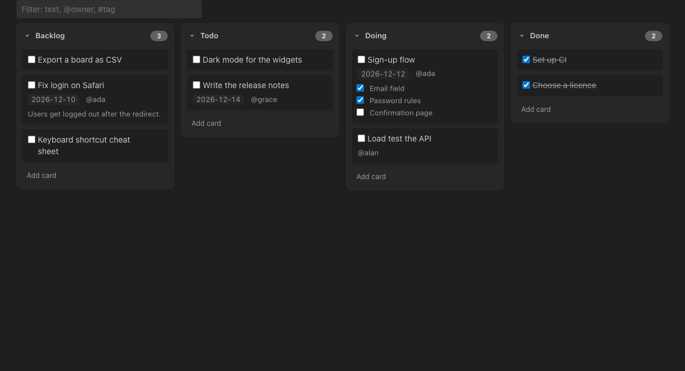
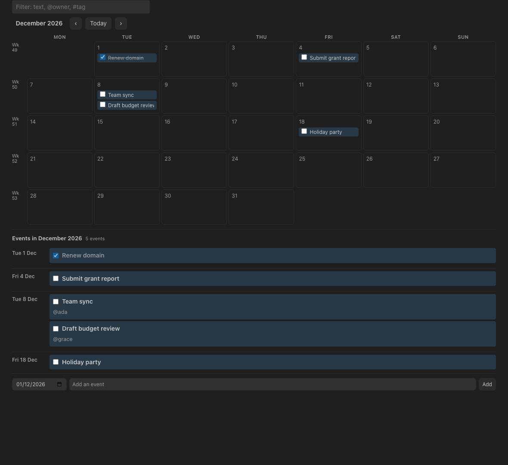
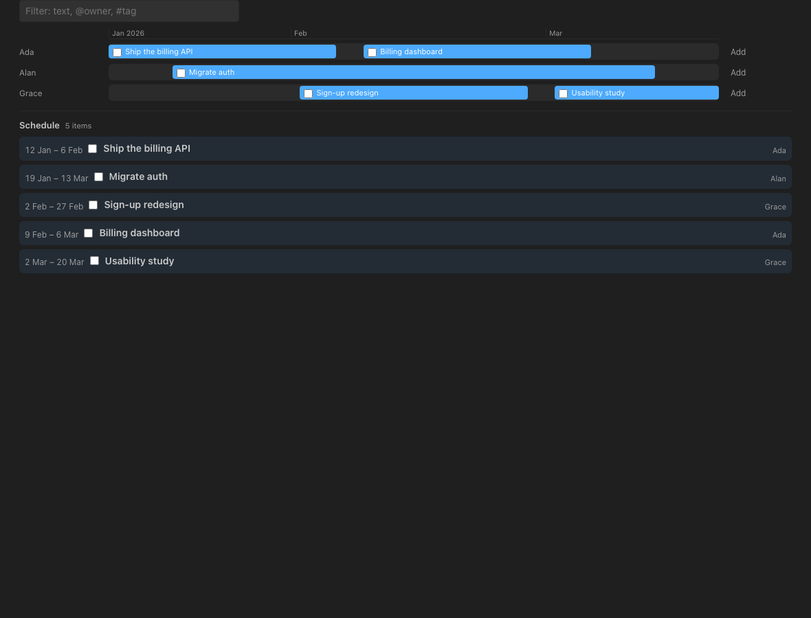
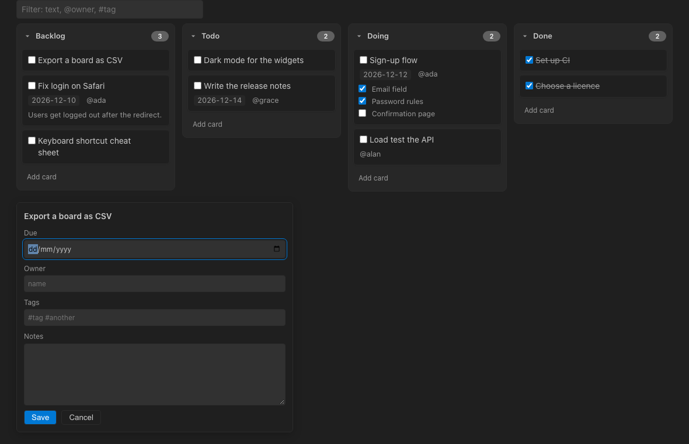
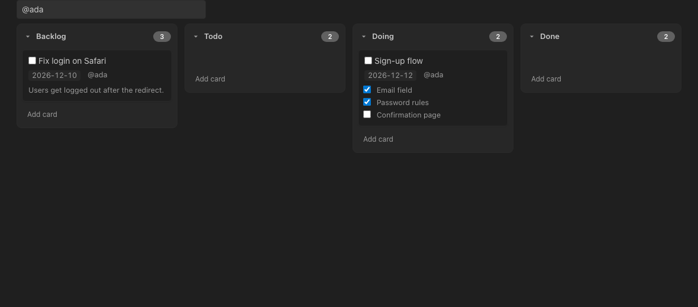
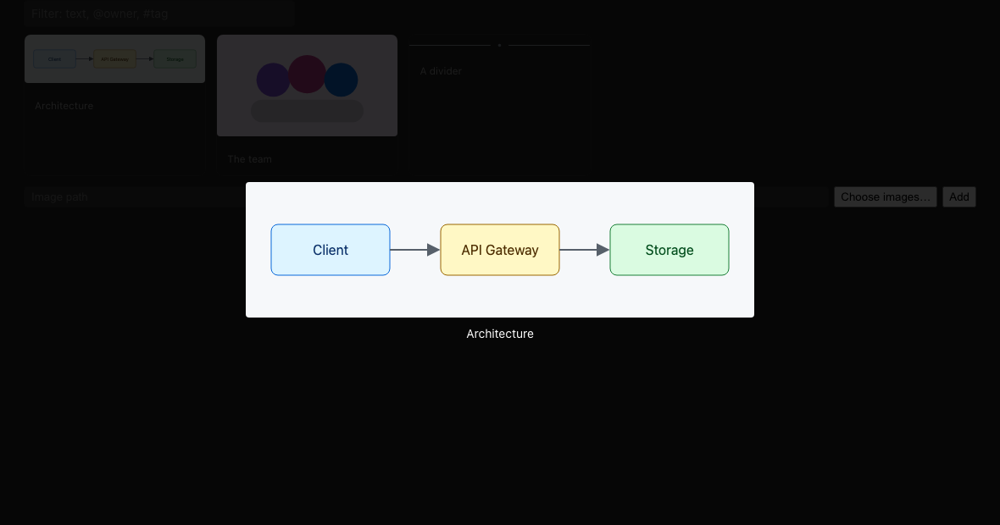
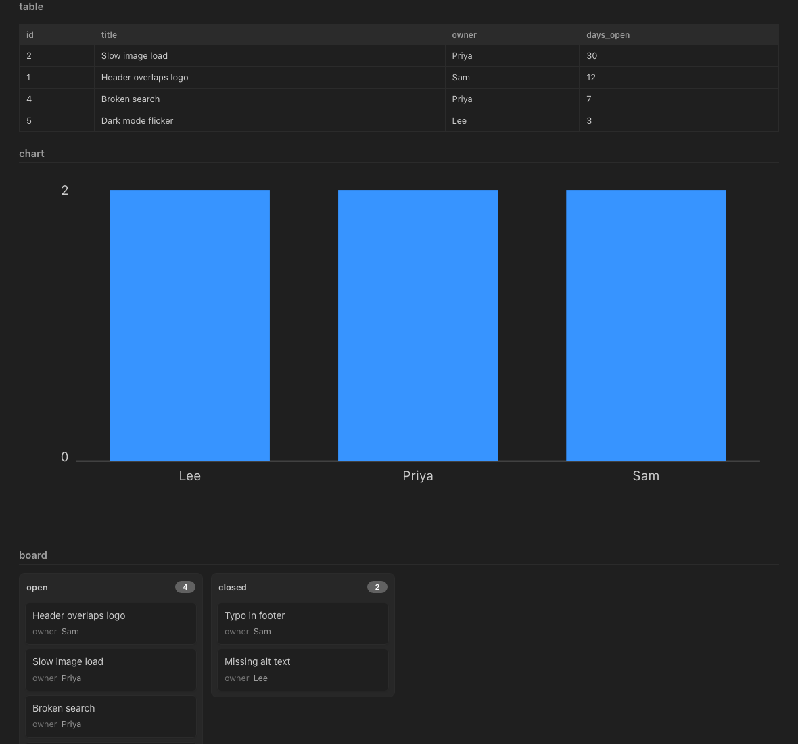
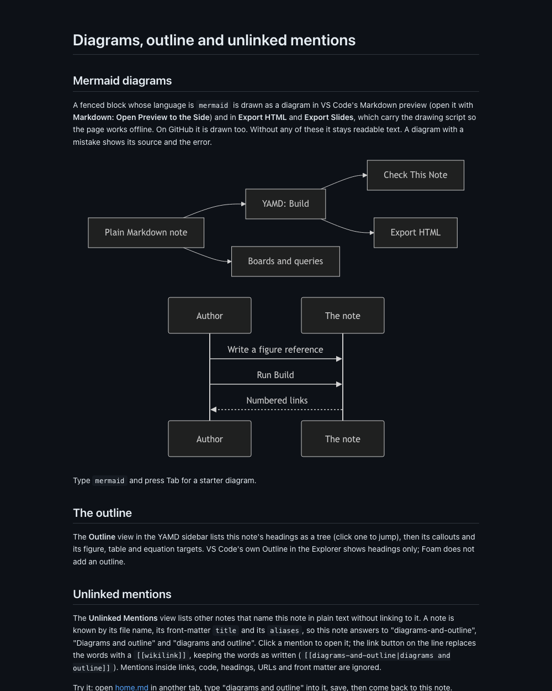
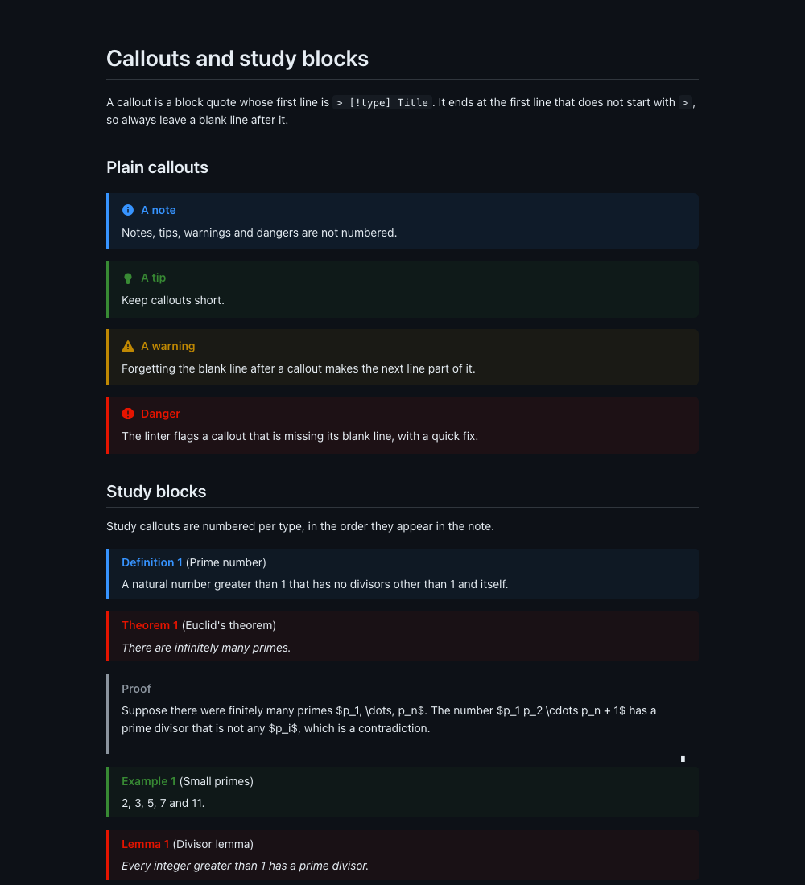

# YAMD — Markdown with widgets

YAMD is a VS Code extension that adds **boards, calendars, timelines, galleries and SQL query views** to plain Markdown notes, plus **callouts, cross-references, citations, a generated table of contents and bibliography, exports, voice notes and study tools**.

Notes stay ordinary `.md` files. Without the extension a widget is just a fenced code block, so nothing breaks on GitHub or in another editor.

````markdown
```kanban sprint-12
## Todo
- [ ] Write the release notes {due=2026-12-14 owner=ada}

## Done
- [x] Kick-off meeting
```
````



In VS Code, a link above the block opens it as a draggable board beside the note. Every edit you make there rewrites only that block in the note, and undo works.

> The images in this README are renders of the extension's real panel HTML, styles and script in headless Chrome with VS Code's Dark Modern colours. They are not captures of a VS Code window.

## Contents

- [What you can do](#what-you-can-do)
- [Install](#install)
- [Quick start](#quick-start)
- [The note format](#the-note-format)
- [Commands](#commands)
- [Settings](#settings)
- [Companion extensions](#companion-extensions)
- [Examples](#examples)
- [Limits and what is not tested](#limits-and-what-is-not-tested)
- [Develop](#develop)
- [What changed from 0.1](#what-changed-from-01)

## What you can do

### Widgets

Five block types, each opened from the link above it or from the Command Palette (`Open Kanban`, `Open Calendar`, `Open Timeline`, `Open Gallery`, `Open Query`, or `Open Widget` for any).

| Type | Made from | You can |
|---|---|---|
| `kanban` | `##` headings as columns, task items as cards | drag between columns, rename, tick, add, collapse |
| `calendar` | task items with `{due=YYYY-MM-DD}` | move to another day, switch months, narrow the list by day or week |
| `timeline` | headings as lanes, items with `{start=…}` and `{due=…}` | drag a bar, read the schedule under the lanes |
| `gallery` | `- ` items, or `source="folder/"` | reorder, add with an image picker, click to enlarge |
| `sql` | a query over a CSV, JSON or SQLite file | view as a table, a board or a bar chart |





**Card details.** The pencil on a card, event or timeline item opens a form for due date, owner, tags and notes. Saving rewrites only that card's lines; if the card changed in the note meanwhile, the edit is refused.



**Filter and overdue.** Every board has a filter box that takes text, `@owner` and `#tag`. Anything not done and past its date is shown in red.



**Gallery.** *Choose images…* opens a file picker; clicking an image enlarges it.



### Queries

Read-only SQL over data files, with the result as a table, a board (`group="column"`) or a chart (`x` and `y`). Queries run on a copy and the file is never changed. **Run Query** writes a Markdown snapshot under the block so the note reads without the extension.

````markdown
```sql
-- id="open-bugs" source="bugs.csv" view="table"
SELECT id, title, owner FROM bugs WHERE status = 'open';
```
````



- **Insert Query…** builds the block from a short form: file, table, columns, filter, view.
- **Run All Queries in This Note** refreshes every snapshot; `yamd.queries.refreshOnSave` does it on save for snapshots that already exist.
- Each query block has an **Edit CSV / Open in SQLite editor / Open data** lens that opens its data file in the matching companion (JSON opens as text). The same is in the palette as **Open Query Data File in Its Editor**.
- Hover a `source="…"` file to see its tables and columns; completion offers the column names inside the SQL.

### Writing

- **Callouts**: `> [!note]`, `tip`, `warning`, `danger`, and numbered study blocks `definition`, `theorem`, `lemma`, `proof`, `example`, `question`, `remark`, `summary`, `derivation`.
- **Cross-references**: put `^fig-name`, `^tbl-name` or `^eq-name` after a figure, table or equation and write `[@fig-name]`. **Build** turns it into `[Figure 2](#fig-name)` and keeps the number current.
- **Citations**: `[@smith2020, p. 4]` with a `.bib` file named in the front matter (`bibliography:` and `citation-style:` apa, ieee, chicago, harvard or mla).
- **Generated regions**: a table of contents and a bibliography between visible `<!-- yamd:… -->` comments.
- **Diagrams**: a ```` ```mermaid ```` block is drawn in VS Code's Markdown preview and in HTML and slide exports (the exported page carries the drawing script, so it works offline).



- **Review marks**: `<ins>` and `<del>`, with commands to accept or reject at the cursor, in a selection or in the whole note.
- **Snippets and completion**: type `kanban`, `callout`, `theorem`, `card`, `toc`, `figure` and press Tab. Completion covers widget types, `source=` files, callout types, `[@` keys and `[@fig-` ids.
- **Insert commands**: Insert Callout, Insert Figure/Table/Equation, Insert Citation, Insert Query, Turn Selection into a Widget, Add Card, Add Event, Add Timeline Item, Add Image to Gallery.

### Getting started and navigation

- **YAMD: Menu** (and a status-bar item) lists every action by task.
- **YAMD: New Note** creates a note from a template: empty (with contents and bibliography), article, project board, meeting notes, reading list, weekly plan, or data note. **Create Sample Note** adds a note and a data file to try things on.
- A 14-step **walkthrough** opens once after install (**YAMD: Open Walkthrough** reopens it).
- The YAMD sidebar lists the widgets in the open note, its **Outline** (headings, callouts, figure, table and equation targets), **Unlinked Mentions** (notes that name this one without linking to it, with a button that turns each into a `[[wikilink]]`), flashcards, deadlines and study progress.

### Audio

**Record Audio and Add Link** records in a panel beside the note (or in your browser if VS Code blocks the microphone there), saves the file next to the note and links it at the cursor. **Transcribe Audio** runs a speech-to-text tool you choose and writes the text under the link as a `Transcript` callout. YAMD sends nothing anywhere; it only runs your command.

### Study

- Flashcards are callouts: `> [!card] Question?` with the answer in the body, reviewed with SM-2 spaced repetition (the schedule is `.yamd/srs.json`).
- **Study This Note** turns a note's definitions, theorems, lemmas and questions into cards in a generated `cards` region.
- Tasks with `{due=…}` become deadlines; a once-a-day reminder lists cards due and deadlines today or overdue.
- A dashboard, a study timer, and **New Study Note** templates (lecture, lab report, exam prep, reading note).

### Export and sharing

| Command | Result |
|---|---|
| Export HTML | a page with numbered callouts, anchors, static widgets and query tables (print it for PDF) |
| Export Slides | a deck that steps with the arrow keys |
| Export as Single Markdown File | `name.export.md` with Build applied, images inlined and query results as tables |
| Export Widget as HTML | one board or query as a read-only page |



### Checks

**Check This Note** gathers every problem into one list, jumps to the line you pick, and fixes the safe ones. The same checks show in the Problems panel as you type.

| Code | Problem |
|---|---|
| W001–W007 | duplicate or invalid widget ids, unclosed blocks, incomplete query headers |
| C001–C002 | callout problems, such as a missing blank line after one |
| M001–M003 | unknown, unclosed or stray `yamd:` markers |
| Q001–Q004 | query problems |
| N001 | an image that does not exist |
| N002 | a data file or gallery folder that does not exist |
| N003 | a `[@fig-…]` reference with no target |
| N004 | a citation key missing from the bibliography file |

## Install

YAMD isn't on the VS Code Marketplace yet, so build the `.vsix` from source. You need [Node.js](https://nodejs.org) 20+, [VS Code](https://code.visualstudio.com) 1.145 or later with its `code` command on PATH, and `make`.

```bash
git clone https://github.com/appmonster007/yamd.git
cd yamd
make install
```

`make install` builds, tests, packages a `.vsix` and installs it (`make install-fast` skips the tests). Installing also brings in the [companion extensions](#companion-extensions). Reload VS Code afterwards. `make help` lists every target, and `make uninstall` removes it.

## Quick start

1. Run **YAMD: Create Sample Note** (Command Palette), or open [examples/getting-started.md](examples/getting-started.md).
2. Click **Open kanban: …** above a board. Drag a card, then press undo in the note.
3. Run **YAMD: Insert Query…**, pick a CSV, and look at the result.
4. Run **YAMD: Build** on a note with `[@fig-…]` references and a `<!-- yamd:toc -->` region.
5. Run **YAMD: Menu** to see everything else.

## The note format

Everything is plain Markdown.

**Widgets** are fenced blocks. The info string is `type id` (a single bare word is the id) or `type id=name`:

````markdown
```calendar releases
- [ ] Beta release {due=2026-12-20 owner=ada}
```

```timeline roadmap
## Platform
- [ ] Migrate auth {start=2026-01-19 due=2026-03-13}
```

```gallery photos
- 
```
````

Cards are list items. `{key=value}` attributes (`due`, `start`, `owner`, anything else you add), `#tags` and indented body lines belong to the card. Ids are lowercase letters, digits and `-`, and unique within a note.

**Queries** are `sql` blocks whose first line is a comment of attributes: `id`, `source`, `view` (`table`, `board` with `group`, or `chart` with `x`, `y` and `type`).

**Markers** are the only comments YAMD reads. Each is on a line of its own and starts with `yamd:`:

````markdown
<!-- yamd:toc depth=3 -->
<!-- /yamd:toc -->

<!-- yamd:bibliography -->
<!-- /yamd:bibliography -->

<!-- yamd:pagebreak -->
````

Generated regions (`toc`, `bibliography`, `cards`, `query:ID`) are rewritten by Build, Study This Note and Run Query, and a second run changes nothing. Any other comment is yours and is never touched. [examples/01-writing/markers.md](examples/01-writing/markers.md) is a one-page guide.

## Commands

All commands are in the Command Palette under **YAMD**, and **YAMD: Menu** groups them by task.

| Area | Commands |
|---|---|
| Start | Menu, New Note, Create Sample Note, Open Walkthrough, Open YAMD Settings |
| Widgets | Open Widget, Open Kanban / Calendar / Timeline / Gallery / Query, Insert Widget, Name Block, Add Card, Add Event, Add Timeline Item, Add Image to Gallery, Turn Selection into a Widget |
| Writing | Insert Callout, Insert Figure Table or Equation, Insert Citation, Go to Reference Target, Build, Accept / Reject Changes |
| Data | Insert Query, Run Query, Run All Queries in This Note, Open Query Data File in Its Editor, Open Query Source in SQL Client, Open in SQLite Editor, Open in CSV Editor, Query CSV with RBQL |
| Audio | Record Audio and Add Link, Transcribe Audio |
| Study | Study This Note, Review Cards, Open Dashboard, Start / Pause / Stop Study Timer, New Study Note, Prune Cards |
| Share | Export HTML, Export PDF (print page), Export Slides, Export as Single Markdown File, Export Widget as HTML |
| Check | Check This Note |
| Linked notes | Show Backlinks, Show Note Graph, Show Tags, Open Daily Note (through Foam) |

## Settings

| Setting | Default | What it does |
|---|---|---|
| `yamd.build.onSave` | off | Run Build whenever a Markdown note is saved |
| `yamd.build.linkCitations` | on | Turn `[@key]` into a link to its bibliography entry |
| `yamd.queries.refreshOnSave` | off | On save, refresh snapshots under query blocks that already have one |
| `yamd.audio.folder` | `audio` | Folder next to the note for recordings (must stay inside the note's folder) |
| `yamd.audio.transcribeCommand` | empty | Speech-to-text command; `{file}` is the recording, for example `whisper-cli -m ~/models/ggml-base.en.bin -nt -f {file}` |
| `yamd.statusBar.enabled` | on | The YAMD status-bar button |
| `yamd.study.newCardsPerDay` | 20 | New cards per review session |
| `yamd.study.pomodoroMinutes` | 25 | Default study-timer length |
| `yamd.study.staleAfterDays` | 14 | Days before a topic counts as stale in the dashboard |
| `yamd.study.reminders` | on | The once-a-day reminder |

## Companion extensions

Installing YAMD installs these with it. [Foam](https://marketplace.visualstudio.com/items?itemName=foam.foam-vscode) is required (backlinks, graph, tags and wikilinks); the others are optional.

- Foam: wikilinks, backlinks, the note graph, tags, daily notes
- SQLite3 Editor: edit `.sqlite` files that queries read
- Edit CSV and Rainbow CSV: edit and query CSV files
- Markdown All in One: list continuation, shortcuts

In an untrusted workspace, boards render but can't be edited, queries may only read files inside the workspace, and the commands that run tools or write generated content ask you to trust it first.

## Examples

[examples/](examples/) has a working note for every feature, with the data and images they use. Each one is checked by the test suite for well-formed widgets, a clean and repeatable Build, and queries that run.

| Folder | What it shows |
|---|---|
| [getting-started.md](examples/getting-started.md) | A tour: one of everything |
| [01-writing](examples/01-writing/) | Callouts, figures and citations, Build, review marks, attributes, audio, markers |
| [02-widgets](examples/02-widgets/) | Kanban, calendar, timeline and gallery |
| [03-queries](examples/03-queries/) | SQL over CSV, JSON and SQLite |
| [04-study](examples/04-study/) | Lecture notes, flashcards, deadlines |
| [05-export](examples/05-export/) | HTML, PDF and slides |
| [06-linked-notes](examples/06-linked-notes/) | Wikilinks, backlinks, tags, graph |
| [07-whats-new](examples/07-whats-new/) | Menu and templates, snippets, card details and filters, gallery picker, query builder, exports, transcription, study this note, check this note |

## Limits and what is not tested

- The unit tests (398) and the integration suite (22 checks in a real VS Code window) pass. The integration suite covers activation, command registration, CodeLens, diagnostics and quick fixes, Build, queries, opening panels, exports, the sidebar, completion and snippets.
- Not yet checked by hand in a live window: the panel's microphone permission, drag and reorder, Restricted Mode, build on save, the companion install prompts, the card form, filter box, gallery picker and enlarge, the menu and status-bar item, daily reminder, the single-file and widget exports, and transcription with a real tool. [docs/qa-checklist.md](docs/qa-checklist.md) lists each check.
- Transcription needs a speech-to-text tool you install yourself.
- Pasting an image uses VS Code's own Markdown paste; YAMD doesn't add its own.
- Foam command names used by the backlinks, graph and tags aliases were taken from Foam's manifest and have not been run.

## Develop

Open `vscode-yamd/` in VS Code and press F5 to start an Extension Development Host. The code layout is in [CONTRIBUTING.md](CONTRIBUTING.md): pure logic in `src/core/**` (never imports `vscode`), a thin extension layer in `src/extension/**` and `src/study/**`, and the panel scripts in `src/webview/**`.

```bash
make deps              # npm install
make build             # bundle into vscode-yamd/dist/
make typecheck
make test              # unit tests
make test-integration  # drives a real VS Code window
make package           # build a .vsix
```

To regenerate the screenshots (needs Google Chrome and a built `dist/`):

```bash
cd vscode-yamd && npm run build && node --import tsx scripts/screenshots.mts
```

CI (`.github/workflows/ci.yml`) runs typecheck, tests, build and packaging on every push; the integration job is allowed to fail until it has run on a hosted runner. Release notes are in [CHANGELOG.md](CHANGELOG.md), and the specification and decision log are in [yamd-1.2.0-spec.md](yamd-1.2.0-spec.md) with the [plan](yamd-1.2.0-plan.md).

## What changed from 0.1

YAMD is no longer a separate language: there are no `.yamd` files, custom preview or editor, `.ydb` databases, document variables or DOCX export. Use Foam for wikilinks and the graph, and the companion SQLite and CSV extensions for editing data. The 0.1 specification is archived in [docs/0.1/](docs/0.1/).

## Contributing

See [CONTRIBUTING.md](CONTRIBUTING.md) and the [Code of Conduct](CODE_OF_CONDUCT.md).

## License

YAMD is licensed under the [MIT License](LICENSE).
