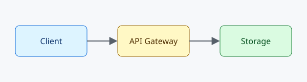

# Attributes and page breaks

Two kinds of HTML comment shape the exported page. They are invisible in editors and in other Markdown viewers.

## Attributes

A comment above an element adds classes and `key=value` attributes to it when the note is exported:

<!-- yamd:attrs class=wide width=60% -->

Ids always use `^id` (see the references example); this comment is only for extra attributes.

## Page breaks

`<!-- yamd:pagebreak -->` starts a new page when the exported HTML is printed.

<!-- yamd:pagebreak -->

## A second page

This heading starts a new page in print and PDF output.

## Try it

1. Run **YAMD: Export HTML** and open `attributes-and-export.html`. The image carries `class="wide"` and `width="60%"`.
2. Change `width=60%` to `width=30%`, export again, and the image shrinks.
3. Print the page (**YAMD: Export PDF** opens it for you). The second page starts at the page-break marker.
