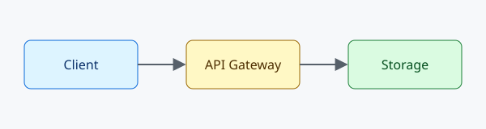

# Gallery

A `gallery` block is a grid of images. Each list item is a card; the alt text is the caption. Drag a card to reorder it.

```gallery sketches
- 
- 
- 
```

Or point at a folder and every image in it is shown, sorted by name:

```gallery id=all-assets source="../assets"
```

A folder gallery is read-only: there is no list in the note to rearrange.
