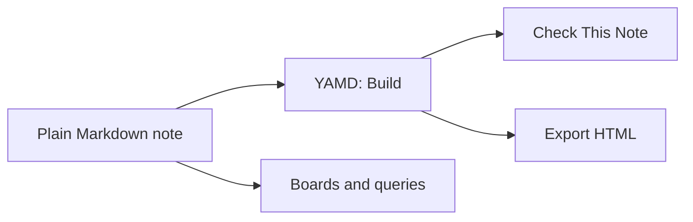
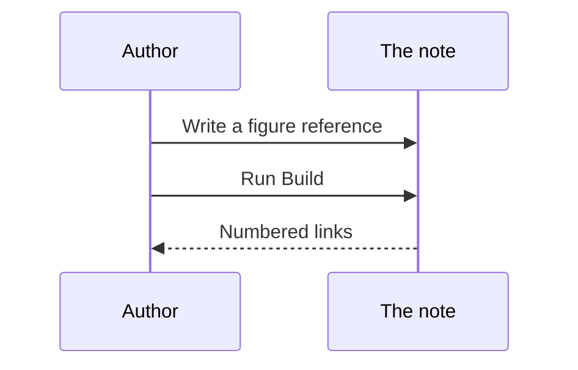

# Diagrams, outline and unlinked mentions

## Mermaid diagrams

A fenced block whose language is `mermaid` is drawn as a diagram in VS Code's Markdown preview (open it with **Markdown: Open Preview to the Side**) and in **Export HTML** and **Export Slides**, which carry the drawing script so the page works offline. On GitHub it is drawn too. Without any of these it stays readable text. A diagram with a mistake shows its source and the error.

Type `mermaid` and press Tab for a starter diagram.

## The outline

The **Outline** view in the YAMD sidebar lists this note's headings as a tree (click one to jump), then its callouts and its figure, table and equation targets. VS Code's own Outline in the Explorer shows headings only; Foam does not add an outline.

## Unlinked mentions

The **Unlinked Mentions** view lists other notes that name this note in plain text without linking to it. A note is known by its file name, its front-matter `title` and its `aliases`, so this note answers to "diagrams-and-outline", "Diagrams and outline" and "diagrams and outline". Click a mention to open it; the link button on the line replaces the words with a `[[wikilink]]`, keeping the words as written (`[[diagrams-and-outline|diagrams and outline]]`). Mentions inside links, code, headings, URLs and front matter are ignored.

Try it: open [home.md](../06-linked-notes/home.md) in another tab, type "diagrams and outline" into it, save, then come back to this note.

## Try it

1. Open **Markdown: Open Preview to the Side**: both diagrams are drawn.
2. Break one (`flowchartt LR`). The preview shows its source and the error.
3. Click a heading in the YAMD **Outline** view to jump to it.
