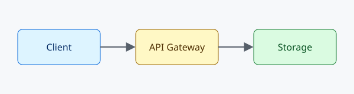

# Gallery picker and enlarge

In a gallery panel, **Choose images…** opens the file dialog, copies nothing, and adds each picked image (with a caption you confirm) as a list item. **Add Image to Gallery** does the same from the Command Palette or the second CodeLens above the block. Click an image to enlarge it; click again or press Escape to close.

```gallery team-photos
- 
- 
```
