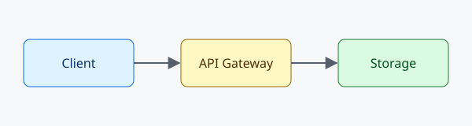
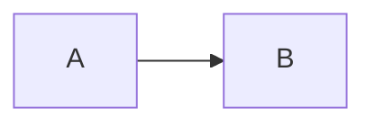

# YAMD cheat sheet

Every item YAMD supports, with the smallest example. All samples sit in code blocks so Build and the checker ignore them. Copy one into a note.

## Widgets

A fenced block: `type id`. Items are list items; `{key=value}`, `#tags` and indented lines belong to the item.

````markdown
```kanban sprint
## Todo
- [ ] Write notes {due=2026-12-14 owner=ada} #docs
## Done
- [x] Kick-off
```

```calendar releases
- [ ] Beta {due=2026-12-20}
```

```timeline roadmap
## Platform
- [ ] Migrate auth {start=2026-01-19 due=2026-03-13}
```

```gallery photos
- 
```
````

Kanban: `##` headings are columns. Calendar needs `due=`. Timeline: `##` headings are lanes, items need `start=` and `due=`. Gallery can instead read a folder: `` ```gallery id=photos source="assets/" ``. Open with the link above the block. Filter box: text, `@owner`, `#tag`.

## Queries

````markdown
```sql
-- id="open-bugs" source="bugs.csv" view="table"
SELECT id, title FROM bugs WHERE status = 'open';
```
````

| `view=` | Extra attributes |
|---|---|
| `table` | none |
| `board` | `group="status"` |
| `chart` | `type="bar"` (or `line`), `x="col"`, `y="col"` |

Sources: CSV, JSON, SQLite. Run Query fills `<!-- yamd:query:open-bugs -->` … `<!-- /yamd:query:open-bugs -->`.

## Callouts

````markdown
> [!note] Title ^optional-id
> Body.
````

Types: `note` `tip` `warning` `danger`; study blocks `definition` `theorem` `lemma` `proof` `example` `question` `remark` `summary` `derivation`; flashcard `card`.

## Flashcards

````markdown
> [!card] What is the capital of Australia?
> Canberra.
````

Add `^id` to the question to keep its schedule through edits. Run **Review Cards**.

## Cross-references

`^id` on its own line after a figure, table or equation; prefix sets the numbering.

````markdown


^fig-arch

$$ E = mc^2 $$

^eq-energy

See [@fig-arch] and [@eq-energy].   (Build turns these into [Figure 1](#fig-arch) links.)
````

Prefixes: `fig-`, `tbl-`, `eq-`. A table needs `Table: Caption` above it.

## Citations

````markdown
---
bibliography: refs.bib
citation-style: apa     # apa ieee chicago harvard mla
---

One key [@lamport1978]; locator [@dean2008, p. 107]; several [@a; @b].
````

## Generated regions

Between a `yamd:` open and close marker, each on its own line. Build rewrites only the inside.

````markdown
<!-- yamd:toc depth=3 -->
<!-- /yamd:toc -->

<!-- yamd:bibliography -->
<!-- /yamd:bibliography -->
````

`cards` (Study This Note) and `query:ID` (Run Query) work the same way.

## Export instructions

````markdown
<!-- yamd:pagebreak -->

<!-- yamd:attrs class=wide width=50% -->

````

## Review marks

````markdown
Meet on <del>Tuesday</del><ins>Wednesday</ins>. Check <mark>this</mark>.
````

Accept / Reject at cursor, in a selection, or in the whole note.

## Diagrams

````markdown

````

## Linked notes (Foam)

````markdown
[[ideas]]  [[people/ada|Ada]]  [[ideas#Parked]]  #planning
````

Front matter `aliases: [start]` and `tags: [hub]` also work.

## Tasks and deadlines

`- [ ] Hand in report {due=2026-12-01}` becomes a deadline in the dashboard and the daily reminder.

## Commands to know

| Do this | Run |
|---|---|
| See everything | **YAMD: Menu** |
| New note from template | **New Note** |
| Fill toc, bibliography, references | **Build** |
| Run queries | **Run Query** / **Run All Queries in This Note** |
| Make cards from a note | **Study This Note** |
| Find problems | **Check This Note** |
| Share | **Export HTML** / **Slides** / **Single Markdown File** / **Widget as HTML** |
| Voice | **Record Audio and Add Link**, **Transcribe Audio** |

Snippets (type + Tab): `kanban` `callout` `theorem` `card` `toc` `figure`.
