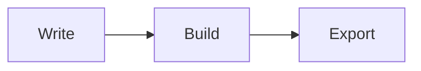

# Getting started

This note uses each part of YAMD once. Everything here is ordinary Markdown: without the extension, widgets show as code blocks and callouts as quotes. Work through the **Try** lines in order.

<!-- yamd:toc depth=2 -->
- [Getting started](#getting-started)
  - [A board](#a-board)
  - [A query](#a-query)
  - [A callout](#a-callout)
  - [A diagram](#a-diagram)
  - [A citation](#a-citation)
  - [References](#references)
  - [Where next](#where-next)
<!-- /yamd:toc -->

## A board

A fenced block named `kanban` is a board. Headings are columns and task items are cards. The word after the type is the block's id.

```kanban first-board
## Todo
- [ ] Open this board with the link above it {due=2026-12-01}
- [ ] Drag a card to another column

## Done
- [x] Install YAMD
```

**Try:**
1. Click **Open kanban: first-board** above the block. The board opens beside the note.
2. Drag a card to another column; double-click a title to rename it.
3. Click the pencil on a card to set due date, owner, tags and notes. Filter with text, `@owner` or `#tag`.
4. Press Ctrl/Cmd+Z in the note: board edits undo.

## A query

A `sql` block whose first line is a comment with `source=` is a read-only query over a data file next to the note.

```sql
-- id="open-bugs" source="03-queries/bugs.csv" view="table"
SELECT id, title, owner FROM bugs WHERE status = 'open' ORDER BY id;
```

**Try:**
1. Click the **Open query** link above the block to see the table.
2. Run **YAMD: Run Query** to write a Markdown snapshot under the block.
3. Change `view="table"` to `view="board" group="owner"` to see the same rows as a board.

## A callout

> [!theorem] Pythagorean theorem ^thm-pyth
> For a right triangle with legs $a$, $b$ and hypotenuse $c$: $a^2 + b^2 = c^2$.

Callouts end at the first line that doesn't start with `>`, so leave a blank line after them. Study callouts are numbered; refer to [Theorem 1](#thm-pyth) and Build turns it into a link.

**Try:** type `[@thm-pyth]` on a new line and run **YAMD: Build**. It becomes a numbered link; run Build again and nothing changes.

## A diagram

A `mermaid` block is drawn in VS Code's Markdown preview and in exports; elsewhere it stays readable text.

**Try:** run **Markdown: Open Preview to the Side**. In any note, type `mermaid` and press Tab for a starter diagram.



## A citation

Distributed systems rely on logical clocks [(Lamport, 1978)](#ref-lamport1978 "cite"). Build links the citation to the reference list below.

**Try:** type `[@` to pick a key from the `.bib` file, run **YAMD: Build**, and the reference list gains an entry. Then run **YAMD: Check This Note**; a clean note reports nothing.

## References

<!-- yamd:bibliography -->
- <a id="ref-lamport1978"></a>Lamport, L. (1978). Time, Clocks, and the Ordering of Events in a Distributed System. <i>Communications of the ACM</i>, <i>21</i>(7), 558–565.
<!-- /yamd:bibliography -->

## Where next

Export it with **YAMD: Export HTML**, **Export Slides** or **Export as Single Markdown File**.

Run **YAMD: Menu** (or click YAMD in the status bar) to see every action, and **YAMD: Open Walkthrough** for a 14-step tour. The other folders show one area each; [07-whats-new](07-whats-new/getting-started-tools.md) covers menus and templates, card details and filters, the query builder, exports, transcription, study and checks.
