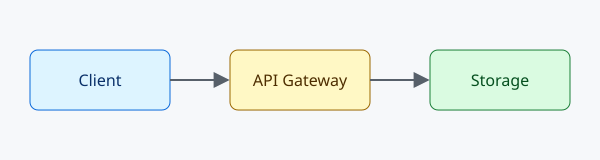
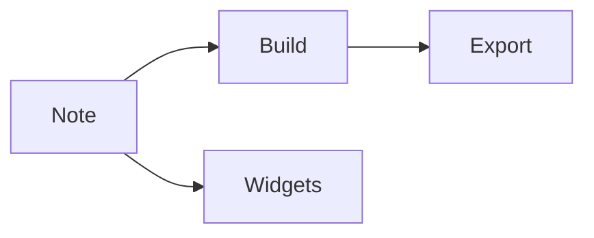

# YAMD showcase

One note that uses every YAMD feature, with CSV, JSON and SQLite data beside it, for developing and testing the extension. Each section ends with a **Try** line.

<!-- yamd:toc depth=2 -->
- [YAMD showcase](#yamd-showcase)
  - [Boards](#boards)
  - [Calendar](#calendar)
  - [Timeline](#timeline)
  - [Gallery](#gallery)
  - [Queries](#queries)
  - [Callouts and study blocks](#callouts-and-study-blocks)
  - [Figures, tables and citations](#figures-tables-and-citations)
  - [Review marks](#review-marks)
  - [Diagram](#diagram)
  - [Flashcards](#flashcards)
  - [Deadlines](#deadlines)
  - [Audio](#audio)
  - [Linked notes](#linked-notes)
  - [Exporting](#exporting)
  - [Editor helpers](#editor-helpers)
  - [References](#references)
<!-- /yamd:toc -->

## Boards

```kanban dev-board
## Backlog
- [ ] Export a board as CSV #idea {owner=ada}
- [ ] Keyboard cheat sheet {due=2026-12-10 owner=grace}
  Print it from the exported page.

## Doing
- [ ] Fix drag into empty column #bug {due=2026-11-20 owner=ada}
  - [x] Reproduce
  - [ ] Patch

## Done
- [x] Card details form {owner=alan}
```

**Try:** open it, drag, rename, add a card, click the pencil, filter with `@ada` or `#bug`, then undo.

## Calendar

```calendar dev-calendar
- [ ] Beta freeze {due=2026-11-20 owner=ada}
- [ ] Release 1.2 {due=2026-12-01 owner=grace}
- [x] Docs review {due=2026-11-03}
```

**Try:** drag an event to another day; click a date to narrow the list.

## Timeline

```timeline dev-timeline
## Widgets
- [ ] Gallery polish {start=2026-11-09 due=2026-11-20 owner=ada}

## Build
- [ ] Citation styles {start=2026-11-16 due=2026-12-04 owner=grace}
```

**Try:** drag a bar sideways, then onto the other lane.

## Gallery

```gallery dev-gallery
- 
- 
```

```gallery id=dev-assets source="../examples/assets"
```

**Try:** reorder, enlarge, **Choose images…**; the folder gallery is read-only.

## Queries

CSV as a table, a board and a chart:

```sql
-- id="open-issues" source="issues.csv" view="table"
SELECT id, title, area, priority, owner FROM issues WHERE status = 'open' ORDER BY days_open DESC;
```

```sql
-- id="issues-by-status" source="issues.csv" view="board" group="status"
SELECT title, owner, status FROM issues;
```

```sql
-- id="issues-per-owner" source="issues.csv" view="chart" type="bar" x="owner" y="n"
SELECT owner, count(*) AS n FROM issues GROUP BY owner ORDER BY owner;
```

JSON, and SQLite with a join:

```sql
-- id="team-levels" source="team.json" view="chart" type="line" x="role" y="level"
SELECT role, level FROM team ORDER BY role;
```

```sql
-- id="shipped" source="data/project.sqlite" view="table"
SELECT f.name, f.area, r.version, r.shipped_on
FROM releases r JOIN features f ON f.id = r.feature_id
ORDER BY r.shipped_on, f.name;
```

```sql
-- id="features-by-status" source="data/project.sqlite" view="board" group="status"
SELECT name, area, effort, status FROM features;
```

**Try:** open each, edit `issues.csv` and save, run **YAMD: Run Query** and **Run All Queries in This Note**, open the SQLite file from its link.

## Callouts and study blocks

> [!note] Plain callout
> Notes, tips, warnings and dangers are not numbered.

> [!definition] Widget ^def-widget
> A fenced block that YAMD turns into an editable panel.

> [!theorem] Round trip ^thm-roundtrip
> Every panel edit rewrites only its own block: $f(\text{note}) = \text{note}'$.

> [!proof]
> The edit replaces the block's line range and nothing else.

> [!lemma] Idempotent build ^lem-build
> Running Build twice changes nothing.

> [!example]
> A kanban board.

> [!remark]
> Without the extension the note is still Markdown.

> [!question] Is a card without a due date overdue?
> No.

> [!summary]
> Widgets edit blocks; Build edits regions.

**Try:** run **Insert Callout…**; delete a blank line under a callout to see the lint quick fix.

## Figures, tables and citations


^fig-arch

Table: Open issues by area

| Area | Open |
| ---- | ---- |
| widgets | 2 |
| queries | 1 |

^tbl-issues

$$ T = n \log n $$

^eq-sort

See [Figure 1](#fig-arch), [Table 1](#tbl-issues), [Equation 1](#eq-sort), [Definition 1](#def-widget) and [Theorem 1](#thm-roundtrip). Logical clocks [(Lamport, 1978)](#ref-lamport1978 "cite"); MapReduce [(Dean & Ghemawat, 2008, p. 107)](#ref-dean2008 "cite: p. 107").

**Try:** add `[@knuth1997]`, run **YAMD: Build**, switch `citation-style`.

## Review marks

Ship on <del>Friday</del><ins>Monday</ins>. Please check this <mark>number</mark>. <!-- Is it 423 tests? -->

**Try:** accept or reject a change at the cursor; try Accept All.

## Diagram



**Try:** open **Markdown: Open Preview to the Side**.

## Flashcards

> [!card] What does Build change?
> Only reference labels, citation links and `yamd:` regions.

> [!card] Which file stores review schedules? ^srs
> `.yamd/srs.json`.

**Try:** run **YAMD: Review Cards**, then **Study This Note**.

## Deadlines

- [ ] Fix drag bug {due=2026-11-20}
- [ ] Cut the release {due=2026-12-01}
- [x] Review the docs {due=2026-11-03}

**Try:** see the **Deadlines** view, start the study timer, open the study dashboard.

## Audio

[Recording 5 Nov, 09:30](../examples/01-writing/audio/note-2026-11-05-0930.wav)

**Try:** run **Record Audio and Add Link**, then **Transcribe Audio** (needs `yamd.audio.transcribeCommand`).

## Linked notes

This note links to [[showcase]] itself and to [[home]] and [[ada]] in the linked-notes example. Plain mention for Unlinked Mentions: Ada Lovelace.

**Try:** run **Show Backlinks (Foam)**, **Show Note Graph (Foam)** and **Show Tags (Foam)**.

## Exporting

<!-- yamd:attrs class=wide width=50% -->


**Try:** **Export HTML**, **Export PDF**, **Export Slides**, **Export as Single Markdown File** and **Export Widget as HTML**.

<!-- yamd:pagebreak -->

## Editor helpers

Snippets (`kanban`, `theorem`, `toc` + Tab), completion (` ```ka `, `> [!`, `[@`, `<!-- yamd:`), the **Outline** view, **YAMD: Menu**, **New Note**, **Check This Note** and the walkthrough.

- [ ] Select these three tasks and run **Turn Selection into a Widget…**
- [ ] Insert a query with **Insert Query…**
- [ ] Run **Check This Note**: this note should be clean

## References

<!-- yamd:bibliography -->
<!-- /yamd:bibliography -->
